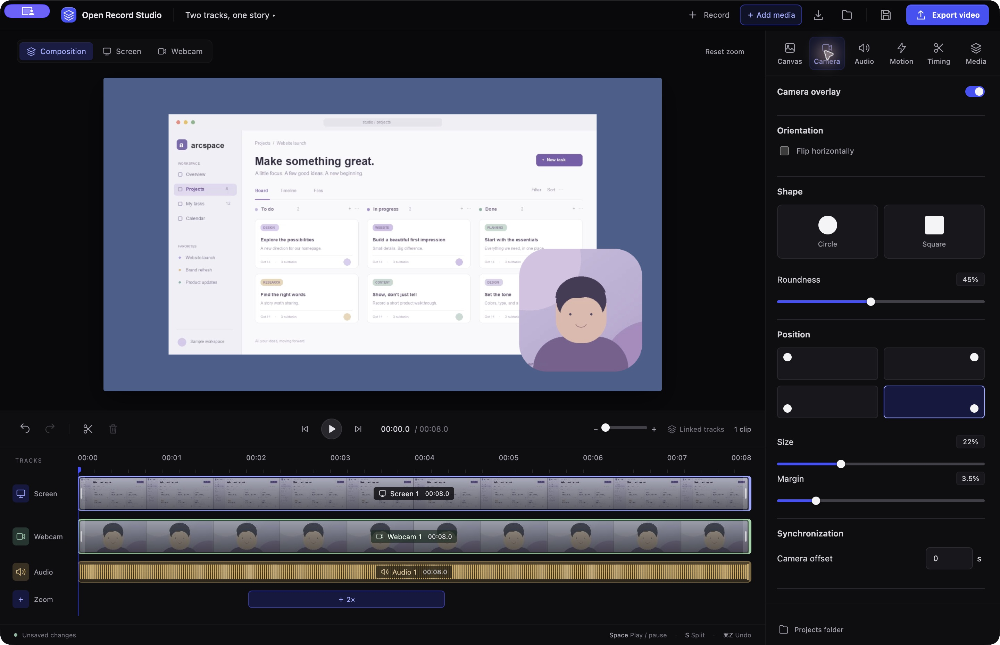
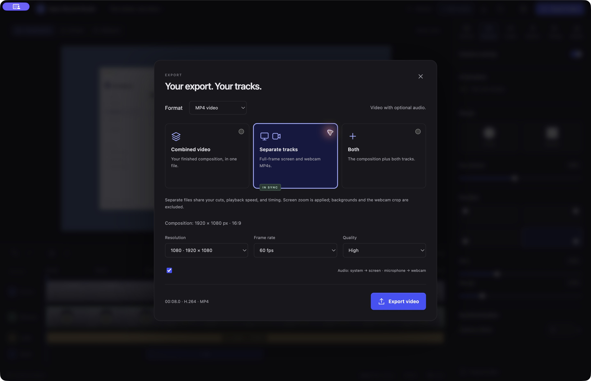

# Open Record Studio

A local macOS screen recorder and video editor. Record your screen and webcam,
edit them on one timeline, then export a finished composition or separate,
synchronized videos.

[Download for macOS](https://github.com/vinipace/open-record-studio/releases) · [Install](docs/install.md) · [Editor guide](docs/guide.md) · [MCP setup](docs/mcp.md) · [MIT license](LICENSE)


## What you can do

- **Record or import.** Capture a screen or window with a camera, microphone, and
  optional system audio, or start from an existing video or image.
- **Edit on a shared timeline.** Cut ranges, trim clips, drag zooms, inspect audio
  waveforms, and pinch to zoom into the timeline. Undo and redo are built in.
- **Focus on the action.** Add smooth zooms manually or generate them from typing,
  selections, and other recorded interactions. Adjust the cursor after recording.
- **Shape your webcam.** Control roundness, size, position, margin, and mirroring.
  Record an additional webcam take while the existing video plays.
- **Finish locally.** Reduce speech background noise with RNNoise, choose canvas
  ratios and social presets, and export MP4 or GIF without uploading your media.
- **Edit through MCP.** Query projects and interaction timestamps, get preview
  images, change cuts and zooms, and start or cancel renders from an MCP client.

## Get started

**Download the app:** get the DMG or ZIP from [Releases](https://github.com/vinipace/open-record-studio/releases).
Drag the app into Applications and install the media tools with `brew install ffmpeg`.
No Node.js or source build is needed. The first release is a signed, unnotarized
preview for Apple silicon Macs running macOS 15+. See [installation instructions](docs/install.md),
including Homebrew installation and current private-repository download access.

### Build from source

The current build targets **Apple silicon Macs**. Screen recording with interaction
tracking requires **macOS 15 or later**. Use Node.js 24, npm, Xcode command-line
tools, and separately installed FFmpeg/ffprobe.

```sh
git clone https://github.com/vinipace/open-record-studio.git
cd open-record-studio
brew install ffmpeg
npm ci
npm start
```

`npm start` builds the native helpers and frontend, then opens the editor. Choose
**Explore a sample project** to try it with generated media, **Record** to capture,
or **Use video or image** to import a file.

Choose a projects folder once. New recordings are named automatically; double-click
a project's title to rename it. macOS requests the recording and device access
needed for the inputs you select. Interaction tracking requires Accessibility and
Input Monitoring access.

To build the `.app` locally:

```sh
npm run package
open "release/Open Record Studio.app"
```

Packaging uses an available Developer ID or an ad-hoc signature. Downloadable
releases require Developer ID signing; the release command supports notarization
with a saved Apple Keychain profile. See [distribution notes](docs/distribution.md)
for signing, third-party notices, and release requirements.

## Your webcam, your framing

Keep a floating webcam preview visible while recording. In the editor, choose the
overlay's shape and placement, adjust its margin, or flip it horizontally. Added
webcam takes have their own microphone audio lane.



## Export together or separately

Choose **Combined video**, **Separate tracks**, or **Both**. Separate videos share
the same cuts, playback speed, and timing:

| Output | Picture | Audio |
| --- | --- | --- |
| `screen.mp4` | Screen, including its zooms | System/source audio |
| `camera.mp4` | Full webcam frame | Microphone audio, including added takes |
| `combined.mp4` | Canvas composition with webcam and media layers | Mixed screen and microphone audio |

Exports also include `export.json` with the saved edit settings and interaction
metadata. GIF export is silent. Rendering shows progress and a time estimate, and
sends a desktop notification when finished, subject to macOS notification settings.



*Screenshots show the actual app using its generated sample artwork.*

## MCP automation

The local MCP companion provides 15 tools for reading projects, querying recorded
interactions, previewing frames, editing cuts and zooms, changing style, and
rendering. Batch edits support validation without saving and revision checks to
avoid overwriting newer changes.

```sh
npm run --silent mcp
```

Connect your client with the [MCP setup guide](docs/mcp.md). The server works on
saved `.framestudio` projects; the desktop app does not need to be open.

## Development and documentation

```sh
npm run typecheck
npm run build
npm test
```

- [Editor guide](docs/guide.md): recording, media layers, timeline, zooms, audio,
  exports, shortcuts, and project format.
- [Interaction capture](docs/interactions.md): tracked events, permissions,
  automatic zoom settings, and metadata.
- [MCP reference](docs/mcp.md): tools, configuration, and editing examples.
- [Distribution](docs/distribution.md): packaging, compatibility, and licensing.

Media stays local. Interaction metadata records event timing, counts, and geometry;
it does not store typed characters, selected text, or clipboard contents.
Accessibility support varies by source app, and secure text fields are excluded.

## License

Project-owned code is licensed under [MIT](LICENSE). Third-party components and
the bundled audio model retain their own terms; see
[third-party acknowledgements](THIRD_PARTY_NOTICES.md).
